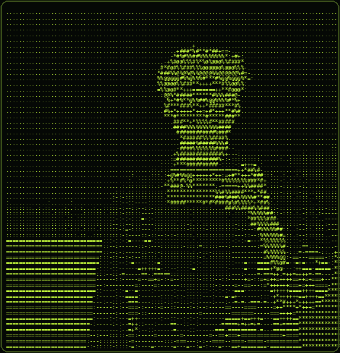
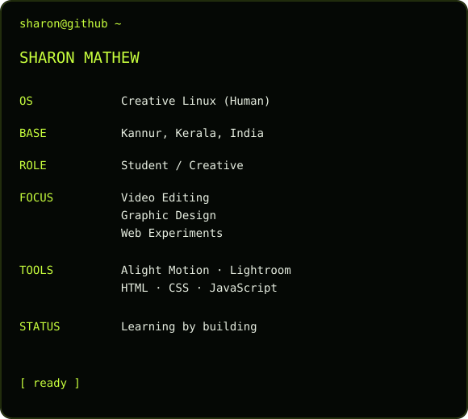

<code>Code · Create · Edit · Learn</code>

## About

I'm Sharon Mathew, a student and creative from Kannur, Kerala, India. I work on web projects, video edits, and graphic design while building my skills through hands-on projects.

## What I work on

- **Web:** small interactive websites and browser-based projects.
- **Video:** editing and colour work.
- **Design:** graphics, layouts, and visual experiments.
- **Learning:** digital marketing, Photoshop, and practical software development.

## Selected projects

- [ULTRON](https://github.com/sharonmathew023-blip/ultron): browser-based AI chat workspace with a Cloudflare Worker backend.
- [Personal portfolio](https://github.com/sharonmathew023-blip/SHARON2004): portfolio for creative work and web projects.
- [Valentine page](https://github.com/sharonmathew023-blip/valentine): interactive single-page experience.
- [Pani Indo](https://github.com/sharonmathew023-blip/pani-indo): local work and job-discovery concept.

## Find me online

- [Portfolio](https://sharonmathew023-blip.github.io/SHARON2004/)
- [GitHub](https://github.com/sharonmathew023-blip)
- [Instagram](https://instagram.com/psy_tranceholic)

This profile is a snapshot of projects, experiments, and things I'm learning. It changes as the work does.
