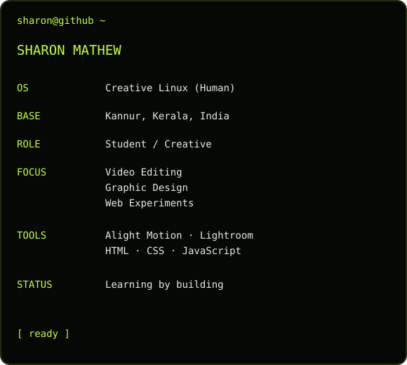

**Code · Create · Edit · Learn**

## About

I'm **Sharon Mathew**, a student and creative from Kannur, Kerala, India. I build browser-based projects, experiment with AI tools, edit videos, and create visual designs.

I like learning by making things and improving them through real projects.

## What I work on

- **Web development:** interactive websites and browser-based applications.
- **AI projects:** chat interfaces, integrations, and practical AI workflows.
- **Video editing:** editing, pacing, and colour work.
- **Graphic design:** layouts and visual experiments.

## Featured projects

| Project | What it is |
| --- | --- |
| [ULTRON](https://github.com/sharonmathew023-blip/ultron) · [Live app](https://sharonmathew023-blip.github.io/ultron/) | Browser-based AI workspace with a Cloudflare Worker backend and skill engine. |
| [SHARON2004](https://github.com/sharonmathew023-blip/SHARON2004) · [Portfolio](https://sharonmathew023-blip.github.io/SHARON2004/) | My creative portfolio for video editing, colour grading, and graphic design. |
| [DEAD ZONE: OUTBREAK 3D](https://github.com/sharonmathew023-blip/Game) | Browser-based 3D zombie survival FPS prototype built with Three.js. |
| [Pani Indo](https://github.com/sharonmathew023-blip/pani-indo) | Malayalam-first local work discovery concept for Kerala. |
| [Echora Messenger](https://github.com/sharonmathew023-blip/echora-messenger) | Lightweight real-time messaging prototype built with Supabase. |
| [Valentine's Day Page](https://github.com/sharonmathew023-blip/valentine) · [Live page](https://sharonmathew023-blip.github.io/valentine/) | Small interactive single-page web experiment. |

## Tools and technologies

`HTML` · `CSS` · `JavaScript` · `Three.js` · `Supabase` · `Cloudflare Workers` · `Git` · `GitHub`

## Currently learning

Professional Diploma in AI Integrated Digital Marketing, along with practical web development, Photoshop, and creative workflows.

## Connect

- Portfolio: [sharonmathew023-blip.github.io/SHARON2004](https://sharonmathew023-blip.github.io/SHARON2004/)
- Instagram: [@psy_tranceholic](https://www.instagram.com/psy_tranceholic/)
- Telegram: [@iam_gigachad](https://t.me/iam_gigachad)

---

  This profile is a snapshot of projects, experiments, and things I'm learning. Updated as the work evolves.

