<h3><code>sharon@github ~ $ ./contributions.sh</code></h3>

<h3><code>sharon@github ~ $ whoami</code></h3>
<table><tr><td valign="top" width="44%"></td><td valign="top" width="56%"></td></tr></table>

<code>Code · Create · Edit · Learn</code>

