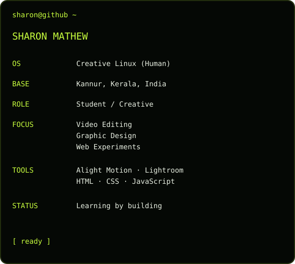

<h3><code>sharon@github ~ $ contributions</code></h3>\n\n\n<h3><code>sharon@github ~ $ whoami</code></h3>

<table>
<tr>
<td valign="top" width="50%"></td>
<td valign="top" width="50%"></td>
</tr>
</table>

<code>Code · Create · Edit · Learn</code>

